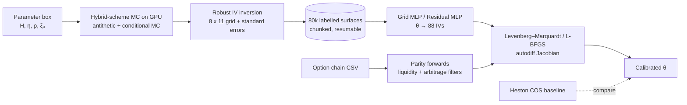

# rough-vol-nn

**Deep calibration of the rough Bergomi model: learn the Monte Carlo pricing map once with a
neural network, then calibrate through it in milliseconds.**


## Problem

Equity-index smiles have an at-the-money skew that explodes like T^(−0.4) at short
maturities, and realised volatility is *rough* (Hurst exponent H ≈ 0.1). The rough
Bergomi model (Bayer, Friz & Gatheral 2016) reproduces both with four parameters
(H, η, ρ, ξ₀), but it is non-Markovian: no PDE, no characteristic function, only Monte
Carlo. A single surface costs tens of milliseconds on a GPU, and a calibration needs
hundreds of surfaces — too slow for daily (let alone intraday) use.

## Approach

The two-step approach of Horvath, Muguruza & Tomas (2021): (1) learn the map
θ = (H, η, ρ, ξ₀) → implied-vol grid offline from Monte Carlo; (2) calibrate through the
network, whose exact Jacobian comes from autodiff.



* **Pricer** — `src/roughvol/rbergomi.py`: κ = 1 hybrid scheme (Bennedsen, Lunde &
  Pakkanen 2017) with FFT convolution, exact discrete compensator (E[V_t] = ξ₀ on the
  grid), antithetic variates and the mixing (conditional-on-W) estimator.
* **Data** — `src/roughvol/data.py`: uniform parameters in the paper's box; 8 maturities
  (1 week … 1.5 y) × 11 strikes on a √T-scaled log-moneyness grid; resumable chunks.
* **Surrogates** — `src/roughvol/surrogate/`: the paper's 3×30 grid MLP and a small residual
  MLP.
* **Calibration** — `src/roughvol/calibration.py`: batched LM in torch, L-BFGS-B, and
  MC-in-the-loop for the speed comparison.
* **Baseline** — `src/roughvol/heston.py`: Heston with the COS method.
* **Real data** — `src/roughvol/market.py`: CSV loader (canonical / NSE bhavcopy / NSE
  UDiFF), put–call-parity forwards, liquidity and static-arbitrage filters.

The maths (fractional kernels, hybrid scheme, why roughness produces the short-dated
skew) and every design decision are in [docs/DESIGN.md](docs/DESIGN.md); the hardest
interview questions with honest answers are in [docs/INTERVIEW_NOTES.md](docs/INTERVIEW_NOTES.md).

## Results

All numbers below are generated by `scripts/build_readme_tables.py` from `results/*.json`.

### Training set

<!-- BEGIN:data -->
<!-- END:data -->

### Surrogate accuracy vs. the Monte Carlo noise floor

<!-- BEGIN:surrogate -->
<!-- END:surrogate -->


### Calibration: parameter recovery

<!-- BEGIN:recovery -->
<!-- END:recovery -->


### Calibration: wall-clock

<!-- BEGIN:speed -->
<!-- END:speed -->

### Rough vs. classical: ATM-skew term structure

<!-- BEGIN:skew -->
<!-- END:skew -->


### Heston (COS) baseline on the same surfaces

<!-- BEGIN:heston -->
<!-- END:heston -->


### Real data

<!-- BEGIN:market -->
<!-- END:market -->

To run on a real chain (e.g. an NSE NIFTY bhavcopy for one trade date):

```bash
python -m roughvol eval --market path/to/chain.csv
```

## Ablations

<!-- BEGIN:ablations -->
<!-- END:ablations -->


## Limitations and failure cases

* **Flat forward variance.** One ξ₀ cannot match a market ATM term structure that is not
  flat; on real data part of the residual is term-structure error, not a failure of
  roughness. Piecewise-constant ξ₀(t) is the standard fix (not implemented).
* **The surrogate learns the discretised model, and that bias dominates.** Labels use
  500 steps/year. The time-step ablation above shows the bias against 2,000 steps/year is
  larger than the Monte Carlo standard error, largest at the shortest maturity and
  smallest H. The surrogate's error *relative to the 500-step model* is below the MC noise
  floor, but its error relative to the continuous-time model is set by the time step.
  The next data run should spend its budget on more steps, not more paths.
* **Fixed domain.** Quotes with z = k/√T outside [−0.42, 0.28] or T outside [0.02, 1.5] are
  dropped, not extrapolated. Weekly options under 7 days are therefore out of scope.
* **H–η trade-off.** Skew level depends on η·√(2H)/((H+½)(H+3/2)) while only its term
  structure pins H; with noisy surfaces H and η errors are correlated (see the recovery
  scatter), worst near the H = 0.5 edge where the short-end slope flattens.
* **Box edges.** Parameters at the edge of the training box are recovered less accurately
  (sigmoid reparametrisation, fewer neighbouring training points).
* **Single trade date, no dynamics.** Parameter stability over time is not studied.

## Reproduce

Hardware used: one laptop RTX 4050 (6 GB), 16 GB RAM. Python 3.11.

```bash
pip install torch==2.5.1 --index-url https://download.pytorch.org/whl/cu121   # or /cpu
pip install -e ".[dev,app,demo]"
make data      # ~1.7 h on the RTX 4050; resumable — just rerun after an interruption
make train     # a few minutes
make eval      # surrogate errors, recovery, speed, Heston, skew, ablations, market
make figures   # PNGs in assets/
make readme    # rebuild the tables above from results/*.json
make demo      # Streamlit app
make test      # unit tests
make quick     # whole pipeline on CPU on a tiny subset (< 5 min; this is what CI runs)
```

Windows without `make`: `python -m roughvol {data,train,eval,figures,all} [--quick]`,
`python scripts/build_readme_tables.py`, `python -m streamlit run app/streamlit_app.py`.
All hyperparameters are in `configs/*.yaml`; `configs/quick.yaml` holds the CI overrides.

## References

* C. Bayer, P. Friz, J. Gatheral. *Pricing under rough volatility.* Quantitative Finance, 2016.
* B. Horvath, A. Muguruza, M. Tomas. *Deep learning volatility: a deep neural network
  perspective on pricing and calibration in (rough) volatility models.* Quantitative
  Finance, 2021.
* M. Bennedsen, A. Lunde, M. S. Pakkanen. *Hybrid scheme for Brownian semistationary
  processes.* Finance and Stochastics, 2017.
* J. Gatheral, T. Jaisson, M. Rosenbaum. *Volatility is rough.* Quantitative Finance, 2018.
* E. Alòs, J. A. León, J. Vives. *On the short-time behavior of the implied volatility for
  jump-diffusion models with stochastic volatility.* Finance and Stochastics, 2007.
* M. Fukasawa. *Asymptotic analysis for stochastic volatility: martingale expansion.*
  Finance and Stochastics, 2011.
* C. Bayer, P. Friz, A. Gulisashvili, B. Horvath, B. Stemper. *Short-time near-the-money
  skew in rough fractional volatility models.* Quantitative Finance, 2019.
* R. McCrickerd, M. S. Pakkanen. *Turbocharging Monte Carlo pricing for the rough Bergomi
  model.* Quantitative Finance, 2018.
* M. Romano, N. Touzi. *Contingent claims and market completeness in a stochastic
  volatility model.* Mathematical Finance, 1997.
* F. Fang, C. W. Oosterlee. *A novel pricing method for European options based on
  Fourier-cosine series expansions.* SIAM J. Sci. Comput., 2008.
* H. Albrecher, P. Mayer, W. Schoutens, J. Tistaert. *The little Heston trap.* Wilmott, 2007.
