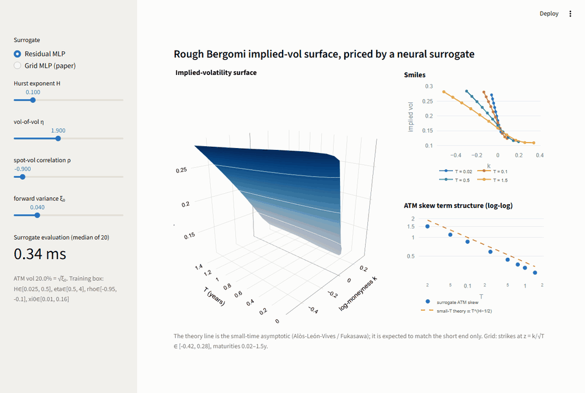
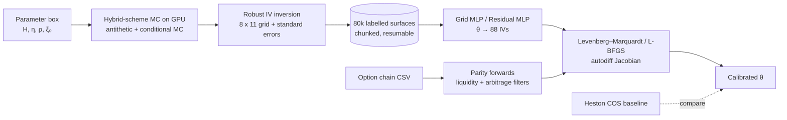
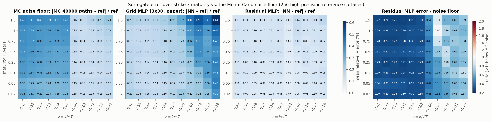
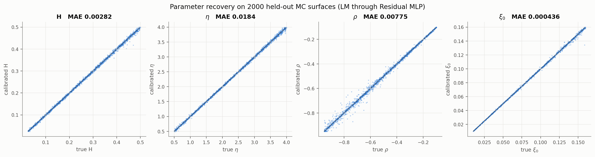
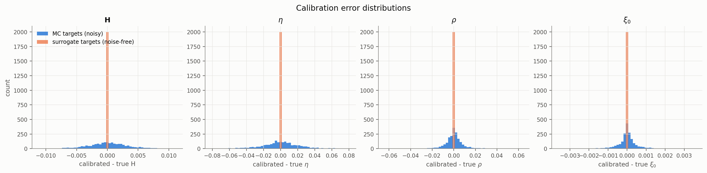
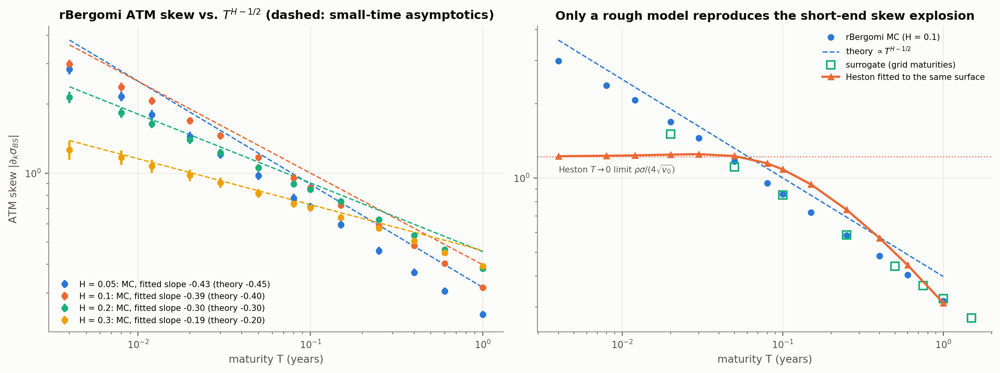
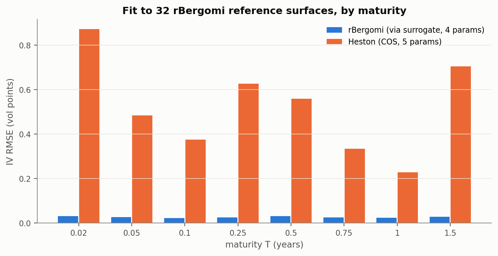
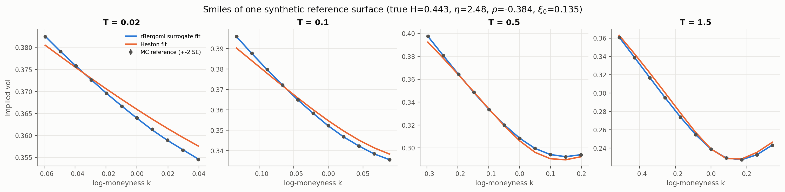
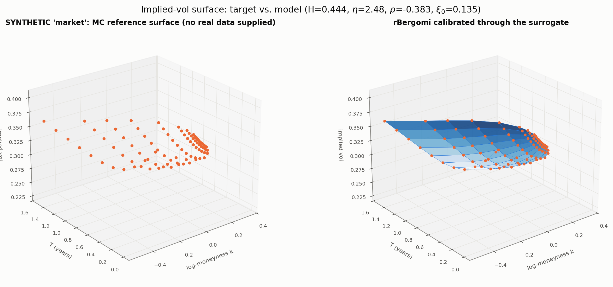
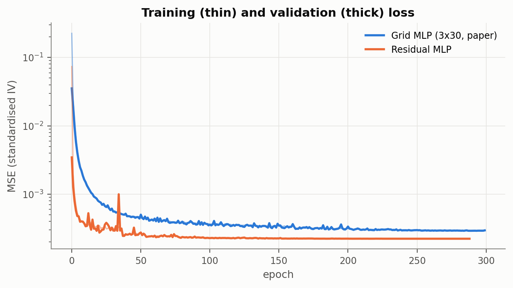

# rough-vol-nn

**Deep calibration of the rough Bergomi model: learn the Monte Carlo pricing map once with a
neural network, then calibrate through it in milliseconds.**



## Problem

Equity-index smiles have an at-the-money skew that explodes like T^(−0.4) at short
maturities, and realised volatility is *rough* (Hurst exponent H ≈ 0.1). The rough
Bergomi model (Bayer, Friz & Gatheral 2016) reproduces both with four parameters
(H, η, ρ, ξ₀), but it is non-Markovian: no PDE, no characteristic function, only Monte
Carlo. A single surface costs tens of milliseconds on a GPU, and a calibration needs
hundreds of surfaces — too slow for daily (let alone intraday) use.

## Approach

The two-step approach of Horvath, Muguruza & Tomas (2021): (1) learn the map
θ = (H, η, ρ, ξ₀) → implied-vol grid offline from Monte Carlo; (2) calibrate through the
network, whose exact Jacobian comes from autodiff.



* **Pricer** — `src/roughvol/rbergomi.py`: κ = 1 hybrid scheme (Bennedsen, Lunde &
  Pakkanen 2017) with FFT convolution, exact discrete compensator (E[V_t] = ξ₀ on the
  grid), antithetic variates and the mixing (conditional-on-W) estimator.
* **Data** — `src/roughvol/data.py`: uniform parameters in the paper's box; 8 maturities
  (1 week … 1.5 y) × 11 strikes on a √T-scaled log-moneyness grid; resumable chunks.
* **Surrogates** — `src/roughvol/surrogate/`: the paper's 3×30 grid MLP and a small residual
  MLP.
* **Calibration** — `src/roughvol/calibration.py`: batched LM in torch, L-BFGS-B, and
  MC-in-the-loop for the speed comparison.
* **Baseline** — `src/roughvol/heston.py`: Heston with the COS method.
* **Real data** — `src/roughvol/market.py`: CSV loader (canonical / NSE bhavcopy / NSE
  UDiFF), put–call-parity forwards, liquidity and static-arbitrage filters.

The maths (fractional kernels, hybrid scheme, why roughness produces the short-dated
skew) and every design decision are in [docs/DESIGN.md](docs/DESIGN.md); the hardest
interview questions with honest answers are in [docs/INTERVIEW_NOTES.md](docs/INTERVIEW_NOTES.md).

## Results

All numbers below are generated by `scripts/build_readme_tables.py` from `results/*.json`.

### Training set

<!-- BEGIN:data -->
| quantity | value |
|---|---|
| parameter sets | 80,000 |
| grid | 8 maturities x 11 strikes |
| paths per set (incl. antithetic) | 40,000 |
| time steps per year | 500 |
| estimator | mixing (conditional on W, antithetic) |
| mean relative IV standard error of a label | 0.310% |
| failed IV inversions | 0.000% |
| GPU pricing time | 75.2 ms per surface (median over chunks) → 1.67 h for the set on NVIDIA GeForce RTX 4050 Laptop GPU |
<!-- END:data -->

### Surrogate accuracy vs. the Monte Carlo noise floor

<!-- BEGIN:surrogate -->
| model | params | mean rel. err vs ref | p95 | p99 | max | error / MC noise floor | 1 surface (CPU) |
|---|---|---|---|---|---|---|---|
| MC, 40,000 paths (noise floor) | – | 0.257% | 0.897% | 1.398% | 8.008% | 1.00 | – |
| Grid MLP (3x30 ELU, paper) | 4,738 | 0.242% | 0.709% | 1.765% | 10.641% | 0.94 | 121 µs |
| Residual MLP (3 blocks x 128) | 111,064 | 0.099% | 0.299% | 0.611% | 5.994% | 0.39 | 209 µs |

Errors are relative IV errors over all 256 x 88 cells of the high-precision reference set (640,000 paths, own relative SE 0.078% on average).
<!-- END:surrogate -->



### Calibration: parameter recovery

<!-- BEGIN:recovery -->
| model / targets | MAE H | MAE η | MAE ρ | MAE ξ₀ | median fit RMSE (vol pts) |
|---|---|---|---|---|---|
| Grid MLP (3x30 ELU, paper) — MC test surfaces | 0.00431 | 0.0225 | 0.00995 | 0.000482 | 0.067 |
| Grid MLP (3x30 ELU, paper) — high-precision reference | 0.00361 | 0.0127 | 0.00697 | 0.000201 | 0.037 |
| Grid MLP (3x30 ELU, paper) — noise-free (own output) | 5.62e-08 | 2.06e-07 | 9.66e-08 | 5.63e-09 | 0.000 |
| Residual MLP (3 blocks x 128) — MC test surfaces | 0.00282 | 0.0184 | 0.00775 | 0.000436 | 0.057 |
| Residual MLP (3 blocks x 128) — high-precision reference | 0.00123 | 0.00604 | 0.00305 | 0.000118 | 0.017 |
| Residual MLP (3 blocks x 128) — noise-free (own output) | 4.79e-08 | 1.69e-07 | 7.23e-08 | 4.72e-09 | 0.000 |
| L-BFGS-B (resmlp, 200 surfaces) | 0.00267 | 0.0178 | 0.00724 | 0.000357 | 0.051 |

LM, 2,000 held-out surfaces, multi-start, batched on GPU.
<!-- END:recovery -->




### Calibration: wall-clock

<!-- BEGIN:speed -->
| calibration | wall-clock per surface | notes |
|---|---|---|
| LM through surrogate (CPU, 1 surface) | 57.4 ms | median of 50, 4 starts, 1 thread, fd64 Jacobian |
| LM through surrogate, batched on GPU | 978 µs | 2,000 surfaces in one call; speed-up 3,976x |
| L-BFGS-B through surrogate (CPU) | 199.9 ms | median of 50 |
| Monte Carlo in the loop (cuda, 40,000 paths) | 3.9 s | median of 5, 52 pricer calls |
| **speed-up (MC / single-surface surrogate LM)** | **68x** | |
<!-- END:speed -->

### Rough vs. classical: ATM-skew term structure

<!-- BEGIN:skew -->
| H | fitted slope (T ≤ 0.1) | theory H − 1/2 |
|---|---|---|
| 0.05 | -0.434 ± 0.003 | -0.450 |
| 0.1 | -0.389 ± 0.009 | -0.400 |
| 0.2 | -0.296 ± 0.007 | -0.300 |
| 0.3 | -0.187 ± 0.007 | -0.200 |
| Heston fit (to H=0.1) | -0.030 ± 0.014 | 0 (flat) |
<!-- END:skew -->



### Heston (COS) baseline on the same surfaces

<!-- BEGIN:heston -->
IV RMSE in vol points on 32 rBergomi reference surfaces:

| | T=0.02 | T=0.05 | T=0.1 | T=0.25 | T=0.5 | T=0.75 | T=1 | T=1.5 | all |
|---|---|---|---|---|---|---|---|---|---|
| rBergomi (surrogate) | 0.03 | 0.03 | 0.02 | 0.03 | 0.03 | 0.03 | 0.02 | 0.03 | 0.02 |
| Heston (COS) | 0.87 | 0.48 | 0.37 | 0.63 | 0.56 | 0.33 | 0.23 | 0.70 | 0.50 |
<!-- END:heston -->





### Real data

<!-- BEGIN:market -->
Real-data calibration: **not run** — no option-chain file was supplied (see *Real data* below). No market data is invented.
<!-- END:market -->

To run on a real chain (e.g. an NSE NIFTY bhavcopy for one trade date):

```bash
python -m roughvol eval --market path/to/chain.csv
```

## Ablations

<!-- BEGIN:ablations -->
| ablation | result |
|---|---|
| time steps: 100/yr vs 2000/yr | mean abs IV diff 0.328 vol pts (T ≤ 0.1: 0.545; rough corner H=0.05: 0.909); MC SE of the difference 0.062 |
| time steps: 200/yr vs 2000/yr | mean abs IV diff 0.189 vol pts (T ≤ 0.1: 0.317; rough corner H=0.05: 0.600); MC SE of the difference 0.062 |
| time steps: 500/yr vs 2000/yr | mean abs IV diff 0.100 vol pts (T ≤ 0.1: 0.161; rough corner H=0.05: 0.267); MC SE of the difference 0.061 |
| time steps: 1000/yr vs 2000/yr | mean abs IV diff 0.057 vol pts (T ≤ 0.1: 0.073; rough corner H=0.05: 0.133); MC SE of the difference 0.060 |
| estimator: plain / mixing price SE | median 1.59 (range 1.02–29.55) ≈ 2.5x fewer paths for equal error |
| network: paper MLP vs residual MLP | mean rel. error 0.242% vs 0.099% |
| targets: noise-free vs MC-noisy (Grid MLP (3x30 ELU, paper)) | MAE(H) 0.0000 vs 0.0043 |
| targets: noise-free vs MC-noisy (Residual MLP (3 blocks x 128)) | MAE(H) 0.0000 vs 0.0028 |
<!-- END:ablations -->



## Limitations and failure cases

* **Flat forward variance.** One ξ₀ cannot match a market ATM term structure that is not
  flat; on real data part of the residual is term-structure error, not a failure of
  roughness. Piecewise-constant ξ₀(t) is the standard fix (not implemented).
* **The surrogate learns the discretised model, and that bias dominates.** Labels use
  500 steps/year. The time-step ablation above shows the bias against 2,000 steps/year is
  larger than the Monte Carlo standard error, largest at the shortest maturity and
  smallest H. The surrogate's error *relative to the 500-step model* is below the MC noise
  floor, but its error relative to the continuous-time model is set by the time step.
  The next data run should spend its budget on more steps, not more paths.
* **Fixed domain.** Quotes with z = k/√T outside [−0.42, 0.28] or T outside [0.02, 1.5] are
  dropped, not extrapolated. Weekly options under 7 days are therefore out of scope.
* **H–η trade-off.** Skew level depends on η·√(2H)/((H+½)(H+3/2)) while only its term
  structure pins H. In the recovery scatter H errors grow towards the H = 0.5 edge (the
  short-end slope flattens, so the term structure carries less information), and ρ errors
  are largest for strongly negative ρ (−0.95 … −0.6), where η and ρ both steepen the
  skew. η has the largest absolute error of the four parameters.
* **Skew constant vs. slope.** Fitted skew *slopes* match H − ½ to within 0.02, but at
  the shortest maturities the MC skew sits ~20–30 % below the asymptotic *constant*: the
  formula is a T → 0 limit, and a 1.5-day option has only 10 time steps.
* **Box edges.** Parameters at the edge of the training box are recovered less accurately
  (sigmoid reparametrisation, fewer neighbouring training points).
* **Single trade date, no dynamics.** Parameter stability over time is not studied.

## Reproduce

Hardware used: one laptop RTX 4050 (6 GB), 16 GB RAM. Python 3.11.

```bash
pip install torch==2.5.1 --index-url https://download.pytorch.org/whl/cu121   # or /cpu
pip install -e ".[dev,app,demo]"
make data      # ~1.7 h on the RTX 4050; resumable — just rerun after an interruption
make train     # a few minutes
make eval      # surrogate errors, recovery, speed, Heston, skew, ablations, market
make figures   # PNGs in assets/
make readme    # rebuild the tables above from results/*.json
make demo      # Streamlit app
make test      # unit tests
make quick     # whole pipeline on CPU on a tiny subset (< 5 min; this is what CI runs)
```

Windows without `make`: `python -m roughvol {data,train,eval,figures,all} [--quick]`,
`python scripts/build_readme_tables.py`, `python -m streamlit run app/streamlit_app.py`.
All hyperparameters are in `configs/*.yaml`; `configs/quick.yaml` holds the CI overrides.

## References

* C. Bayer, P. Friz, J. Gatheral. *Pricing under rough volatility.* Quantitative Finance, 2016.
* B. Horvath, A. Muguruza, M. Tomas. *Deep learning volatility: a deep neural network
  perspective on pricing and calibration in (rough) volatility models.* Quantitative
  Finance, 2021.
* M. Bennedsen, A. Lunde, M. S. Pakkanen. *Hybrid scheme for Brownian semistationary
  processes.* Finance and Stochastics, 2017.
* J. Gatheral, T. Jaisson, M. Rosenbaum. *Volatility is rough.* Quantitative Finance, 2018.
* E. Alòs, J. A. León, J. Vives. *On the short-time behavior of the implied volatility for
  jump-diffusion models with stochastic volatility.* Finance and Stochastics, 2007.
* M. Fukasawa. *Asymptotic analysis for stochastic volatility: martingale expansion.*
  Finance and Stochastics, 2011.
* C. Bayer, P. Friz, A. Gulisashvili, B. Horvath, B. Stemper. *Short-time near-the-money
  skew in rough fractional volatility models.* Quantitative Finance, 2019.
* R. McCrickerd, M. S. Pakkanen. *Turbocharging Monte Carlo pricing for the rough Bergomi
  model.* Quantitative Finance, 2018.
* M. Romano, N. Touzi. *Contingent claims and market completeness in a stochastic
  volatility model.* Mathematical Finance, 1997.
* F. Fang, C. W. Oosterlee. *A novel pricing method for European options based on
  Fourier-cosine series expansions.* SIAM J. Sci. Comput., 2008.
* H. Albrecher, P. Mayer, W. Schoutens, J. Tistaert. *The little Heston trap.* Wilmott, 2007.
